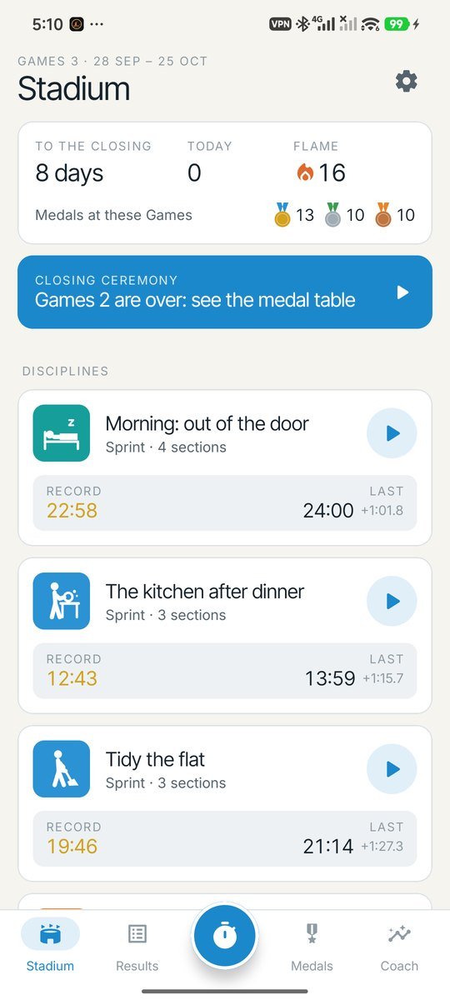
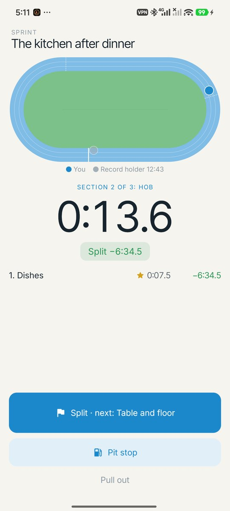
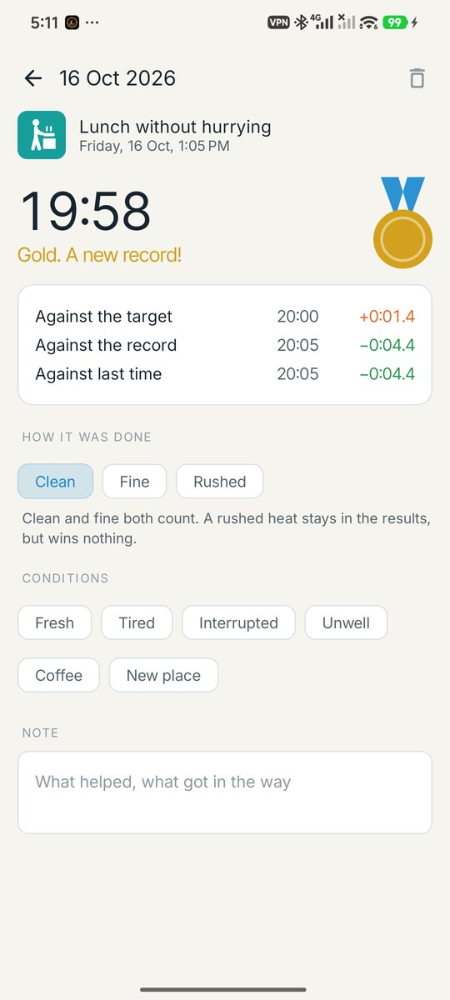
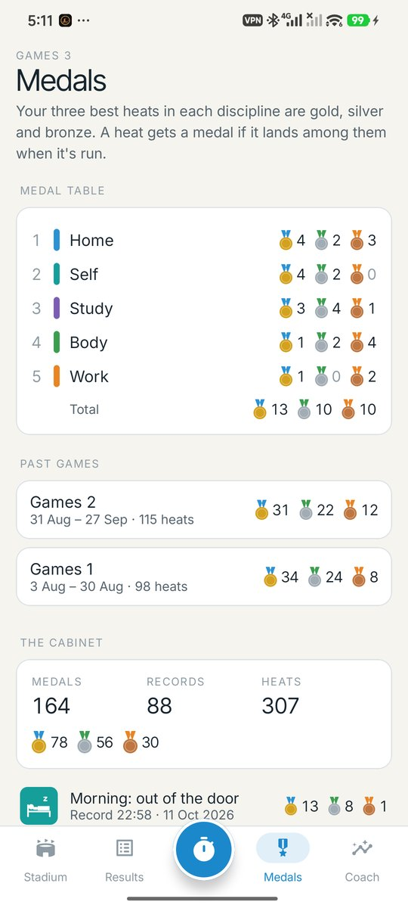
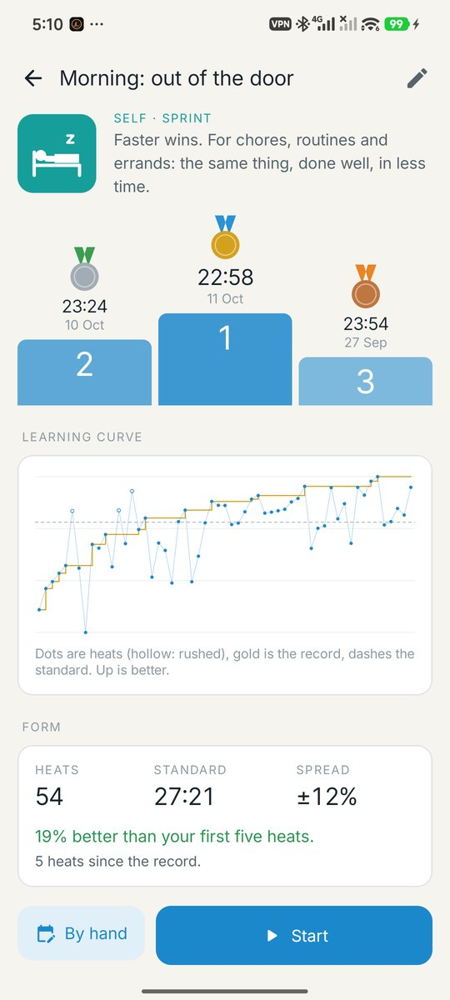
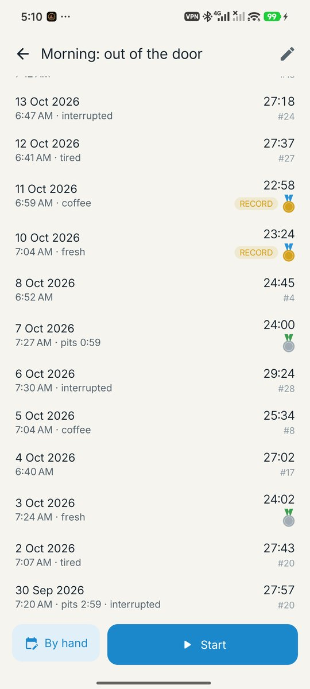
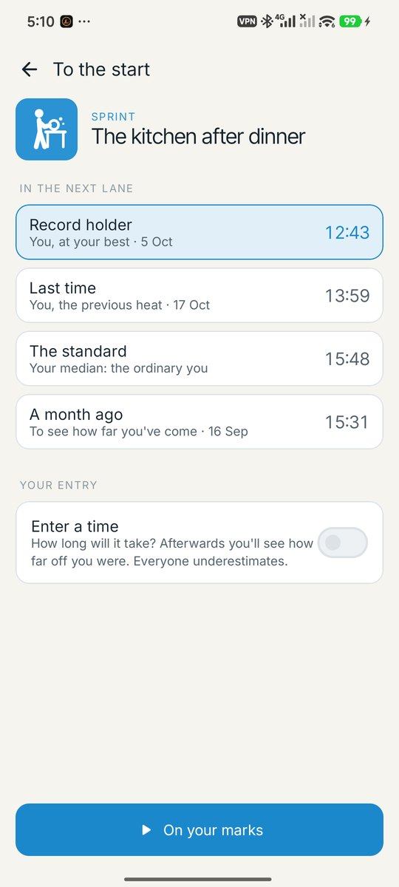
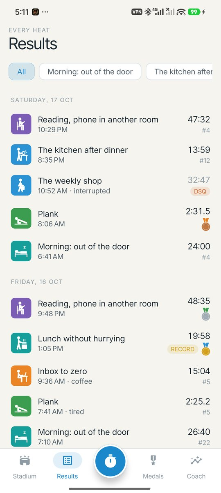
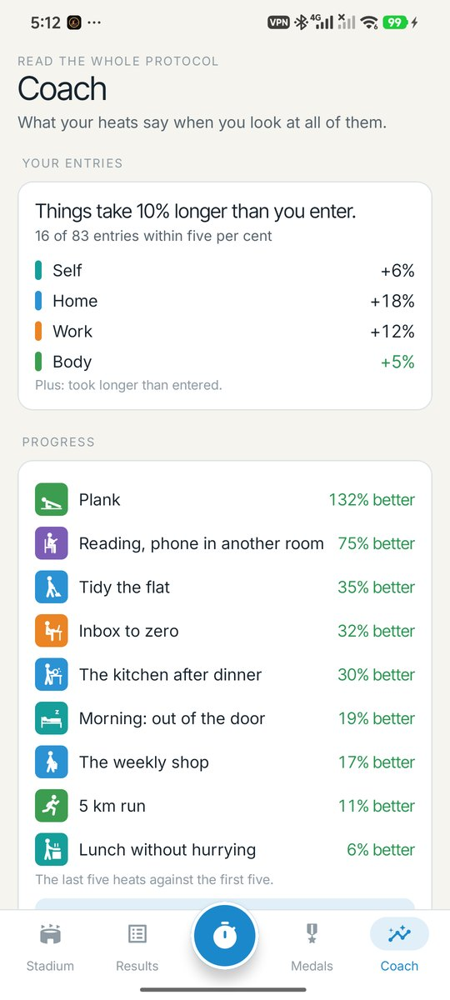
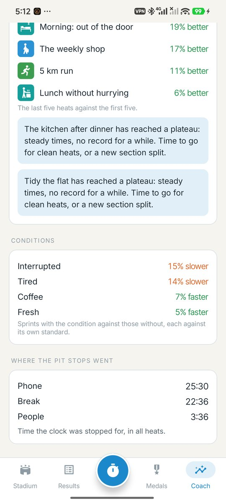

<div align="center">


# Podium

### Race the one who did it yesterday.

*Every task you do again and again becomes a discipline. Start the clock, and in the next lane runs a ghost: you, last time or at your best. Splits, medals, a medal table every four weeks, and a coach who reads the whole protocol. Free, no ads, no account, no internet permission.*

[](https://github.com/bigdevwhale/podium/actions/workflows/android.yml)
[](https://github.com/bigdevwhale/podium/releases/latest)


[](LICENSE)

**English** · [Русский](README.ru.md) · [Changelog](CHANGELOG.md)

   

</div>

---

## The idea

Speedrunners don't race other people. They race their own ghost and their own splits. Podium brings that to the everyday: the morning out of the door, the kitchen after dinner, the inbox, a plank. You never compete with anyone else, only with yourself. Speed is never the point on its own: a rushed heat is disqualified.

It looks like Munich, summer 1972: white paper, a light-blue sky, green grass, and pictograms in the manner of Otl Aicher.

## How it works

1. **Disciplines.** Name something you do again and again, and pick a pictogram (33 of them), a part of life and how it's won: **sprint** (faster wins), **endurance** (longer wins) or **pace** (closest to a set time wins, for what shouldn't be rushed).
2. **Race the ghost.** On your marks, get set, go. On the oval, the ghost runs in the inside lane: your record, last time, your median ("the standard") or you a month ago. The scoreboard says whether you're ahead and when the ghost finishes.
3. **Finish and say how it went.** Clean, fine or rushed (DSQ). Tired, interrupted, fresh, coffee. The result shows your place, your medal and how you stand against the record, the standard and last time.

## What's inside

| | Feature | How it works |
|---|---|---|
| 👻 | **The ghost** | Record holder, last time, the standard or a month ago, drawn on the track at its own pace. Pace disciplines get a pacemaker. |
| 🏁 | **Splits** | Cut a long task into sections. Each split shows a live delta against the ghost's, a star for a section never run faster, and *the perfect heat*: every section at its best, put together. |
| 🥇 | **Medals** | The first three heats are qualifying. After that, a heat that lands in your top three gets gold, silver or bronze, and the best ever is the record. |
| 🏟️ | **The Games** | Every four weeks (1, 2, 4 or 8, as you like): a medal table kept by parts of life instead of nations, Games records and a closing ceremony the morning after. |
| 🔥 | **The flame** | Days in a row with at least one heat. |
| 📝 | **Your entry** | Before the start, guess how long it will take. The coach shows how far off you are, by part of life: "things at home take 24% longer than you think". |
| ⛽ | **Pit stops** | The clock stops while you're pulled away. Say what took you (phone, people, break), and see where the stopped time went. |
| 🧑‍🏫 | **The coach** | The protocol read as a whole: the accuracy of your entries, how much tiredness or interruptions cost you, progress since your first heats, and plateaus, with what to try next. |
| 📈 | **Learning curve** | Every heat as a dot, the record as a gold step line, the standard dashed, and a three-step podium with your best heats. |
| 🔁 | **Relays** | Several disciplines in a row: finish one and the next starts at once. The relay keeps its own record. |
| 📷 | **Photo finish** | Within a second and a half of the record, the judges' photo. |
| 🔔 | **In the shade** | A live clock in the notification with the ghost, split and pit-stop buttons, so the phone can stay in a pocket. A quick-settings tile and launcher shortcuts for your most-raced disciplines. |
| ✍️ | **By hand** | Timed with something else? Write it in. |
| 💾 | **Backup** | Everything in one JSON file. |

## Privacy

There is no account, no cloud, no analytics and no internet permission. Everything stays on the phone.

## Screenshots

     

## Build

```bash
./gradlew assembleDebug             # app.podium.dev
./gradlew assembleDebug -Pdemo      # app.podium.demo, a made-up season for screenshots
./gradlew testDebugUnitTest         # unit tests
./gradlew testDebugUnitTest -Prender --tests '*RenderArt*'   # the pictograms to app/build/art
```

Kotlin, Jetpack Compose, Room, DataStore. The pictograms, the track and the medals are drawn on a Compose canvas. Fonts: Inter and Inter Tight (OFL).

The pictograms are drawn after Otl Aicher's for Munich 1972. Podium has nothing to do with the IOC or any Olympic organisation.

Part of [Stillcraft](https://bigdevwhale.github.io/stillcraft/). MIT licence.
