<div align="center">

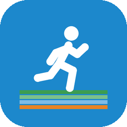

# Podium

### Гонка с тем, кто делал это вчера.

*Каждое дело, которое повторяется, становится дисциплиной. Запустите секундомер, и по соседней дорожке побежит призрак: вы в прошлый раз или на рекорде. Отсечки, медали, медальный зачёт каждые четыре недели и тренер, который читает весь протокол. Бесплатно, без рекламы, без аккаунта, без доступа в интернет.*

[](https://github.com/bigdevwhale/podium/actions/workflows/android.yml)
[](https://github.com/bigdevwhale/podium/releases/latest)


[](LICENSE)

[English](README.md) · **Русский** · [Изменения](CHANGELOG.md)

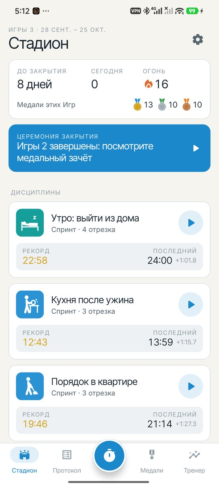 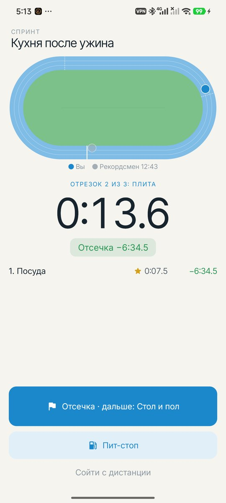 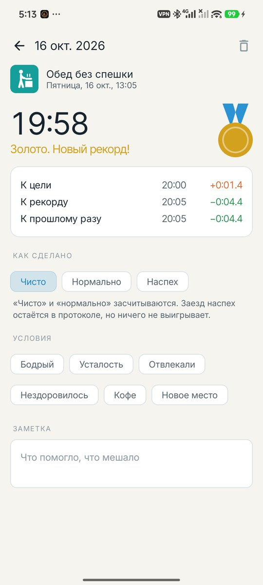 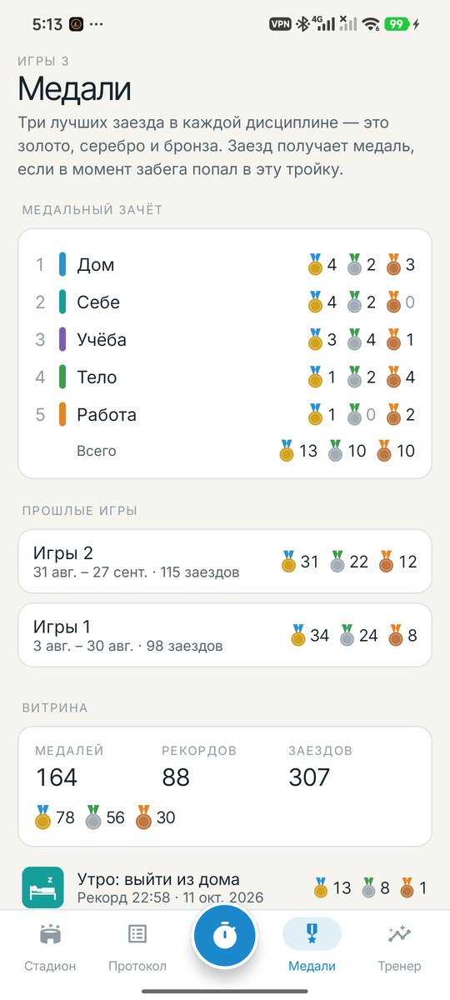

</div>

---

## Идея

Спидраннеры не соревнуются с другими людьми. Они бегут против своего призрака и своих отсечек. Podium переносит это в обычную жизнь: утро до выхода из дома, кухня после ужина, почта, планка. Соревнуетесь вы только с собой. Скорость сама по себе не цель: заезд наспех дисквалифицируется.

Выглядит как Мюнхен, лето 1972 года: белая бумага, светло-голубое небо, зелёная трава и пиктограммы в духе Отля Айхера.

## Как это работает

1. **Дисциплины.** Назовите то, что делаете снова и снова, выберите пиктограмму (их 33), сферу жизни и способ победы: **спринт** (побеждает быстрый), **выносливость** (побеждает долгий) или **темп** (побеждает тот, кто ближе к заданному времени — для того, что нельзя делать бегом).
2. **Гонка с призраком.** На старт, внимание, марш. На овале по внутренней дорожке бежит призрак: ваш рекорд, прошлый раз, ваша медиана («норматив») или вы месяц назад. Табло показывает, впереди ли вы и когда призрак финиширует.
3. **Финиш и как всё прошло.** Чисто, нормально или наспех (DSQ). Усталость, отвлекали, бодрый, кофе. Результат показывает место, медаль и сравнение с рекордом, нормативом и прошлым разом.

## Что внутри

| | Функция | Как работает |
|---|---|---|
| 👻 | **Призрак** | Рекордсмен, прошлый раз, норматив или месяц назад — бежит по дорожке в своём темпе. В дисциплинах на темп — пейсмейкер. |
| 🏁 | **Отсечки** | Разбейте длинное дело на отрезки. На каждой отсечке видна разница с призраком, звезда за отрезок, пройденный быстрее, чем когда-либо, и *идеальный заезд*: все отрезки в лучшем виде, вместе. |
| 🥇 | **Медали** | Первые три заезда — квалификация. Дальше заезд, попавший в вашу тройку лучших, получает золото, серебро или бронзу, а лучший за всё время — рекорд. |
| 🏟️ | **Игры** | Каждые четыре недели (или 1, 2, 8 — как удобно): медальный зачёт по сферам жизни вместо стран, рекорды Игр и церемония закрытия на следующее утро. |
| 🔥 | **Огонь** | Дни подряд хотя бы с одним заездом. |
| 📝 | **Заявка** | Перед стартом угадайте, сколько это займёт. Тренер покажет, насколько вы ошибаетесь, по сферам жизни: «домашние дела занимают на 24% больше, чем вы думаете». |
| ⛽ | **Пит-стопы** | Секундомер стоит, пока вас отвлекли. Отметьте причину (телефон, люди, перерыв) и посмотрите, куда ушло время. |
| 🧑‍🏫 | **Тренер** | Протокол целиком: точность заявок, во сколько обходятся усталость и отвлечения, прогресс с первых заездов и плато — с подсказкой, что попробовать дальше. |
| 📈 | **Кривая обучения** | Каждый заезд — точка, рекорд — золотая ступенчатая линия, норматив — пунктир, и пьедестал из трёх лучших заездов. |
| 🔁 | **Эстафеты** | Несколько дисциплин подряд: финишировали — следующая начинается сразу. У эстафеты свой рекорд. |
| 📷 | **Фотофиниш** | Если до рекорда меньше полутора секунд — снимок судей. |
| 🔔 | **В шторке** | Живой секундомер в уведомлении с призраком и кнопками отсечки и пит-стопа — телефон может лежать в кармане. Плитка в быстрых настройках и ярлыки на иконке для самых частых дисциплин. |
| ✍️ | **Вручную** | Засекали чем-то другим? Запишите. |
| 💾 | **Резервная копия** | Всё в одном JSON-файле. |

## Приватность

Нет аккаунта, облака, аналитики и доступа в интернет. Всё остаётся на телефоне.

## Скриншоты

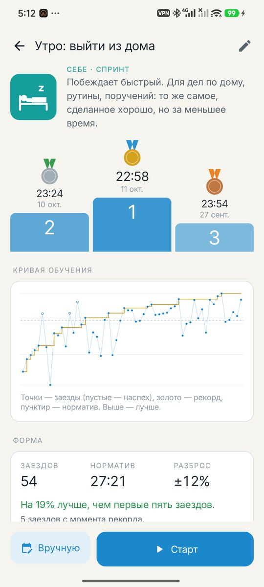 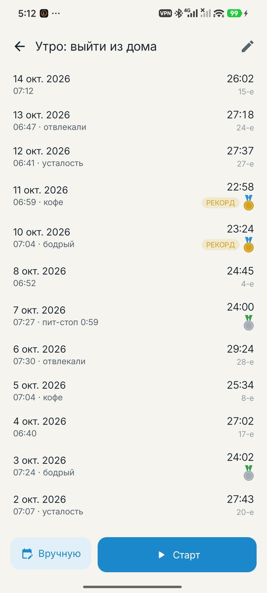 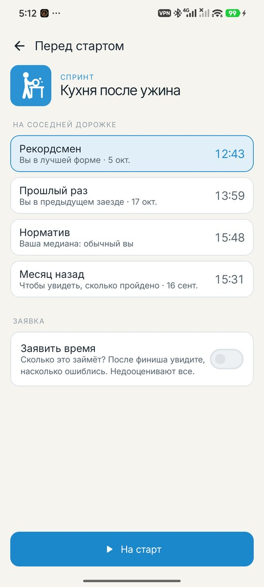 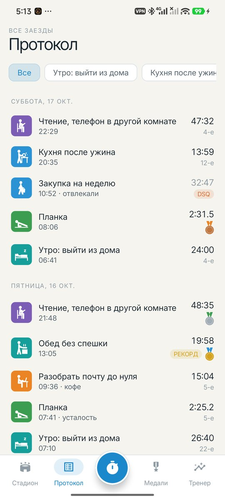 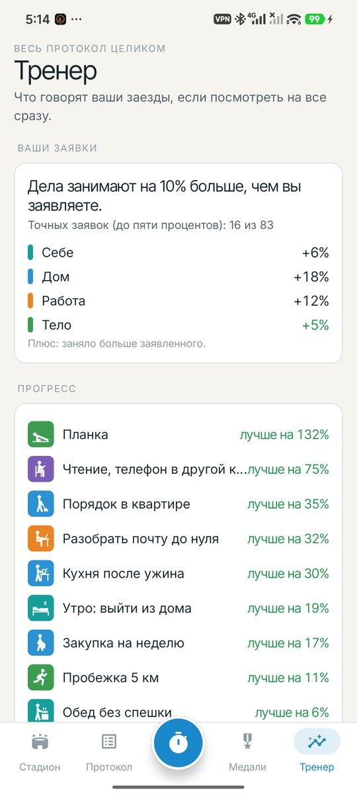 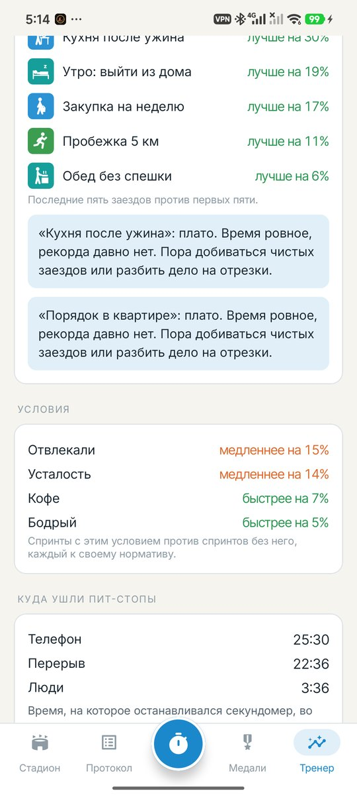

## Сборка

```bash
./gradlew assembleDebug             # app.podium.dev
./gradlew assembleDebug -Pdemo      # app.podium.demo, выдуманный сезон для скриншотов
./gradlew testDebugUnitTest         # юнит-тесты
./gradlew testDebugUnitTest -Prender --tests '*RenderArt*'   # пиктограммы в app/build/art
```

Kotlin, Jetpack Compose, Room, DataStore. Пиктограммы, дорожка и медали нарисованы на Compose Canvas. Шрифты: Inter и Inter Tight (OFL).

Пиктограммы нарисованы по мотивам Отля Айхера для Мюнхена-1972. Podium не имеет отношения к МОК и олимпийским организациям.

Часть [Stillcraft](https://bigdevwhale.github.io/stillcraft/). Лицензия MIT.
